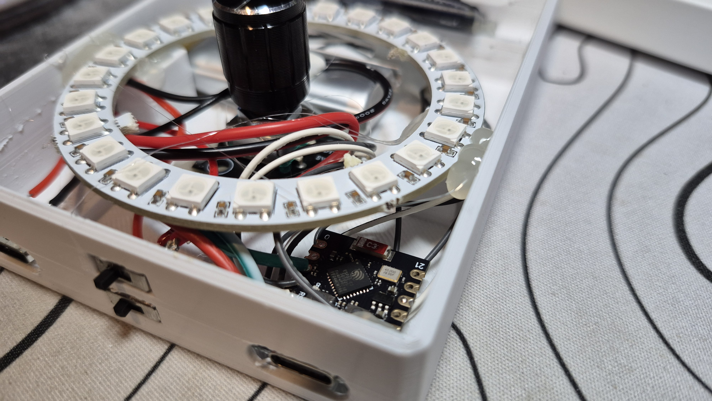
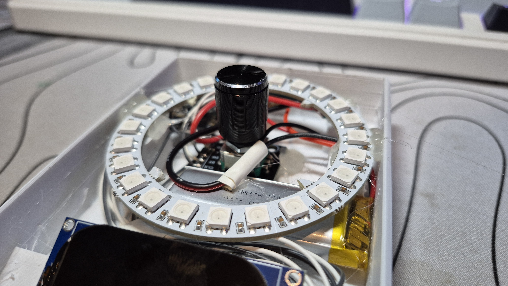

# DialDisp

**Wireless Smart Rotary Desk Controller & Ambient Light Display**

DialDisp is a custom 3D-printed wireless Bluetooth LE (BLE HID) rotary desk controller powered by an **ESP32-C3**. It combines an angled **2.01" IPS TFT display (240×296 JD9853)**, a diffused **24-LED WS2812B RGB NeoPixel halo ring**, and a tactile **rotary encoder with push button** inside a rechargeable battery-powered enclosure with **USB-C charging** and background **Wi-Fi NTP atomic time synchronization**.


---

## ✨ What It Can Do

DialDisp turns a single rotary knob into a multi-mode wireless workstation controller and ambient desk lamp—no custom PC companion software required. Once paired via Bluetooth (`DialDisp`), it works natively using standard BLE HID protocols.

### 7 Interactive Modes

1. **Audio Control (`AUDIO`)**
   - Adjust PC system volume in 5% increments with sub-pixel 24-LED ring visualization and an on-screen progress bar.
   - Short click toggles **Mute / Unmute**.
   - Includes a one-click **PC Audio 50% Calibration Sync** inside Setup to align the controller's percentage readout with your PC volume.

2. **PC Screen Brightness (`PC LICHT`)**
   - Smoothly adjust display/laptop brightness (`0%–100%`) over BLE Consumer Control with synchronized LED ring feedback.

3. **Media Playback (`MEDIA`)**
   - Short click toggles **Play / Pause**.
   - Rotating clockwise/counter-clockwise skips to **Next / Previous** track with directional LED pulse animations and live transport icons.

4. **Smart Scroll & Feed Navigation (`SCROLL`)**
   - Turning the knob sends smooth BLE mouse wheel scroll events accompanied by a rotating LED chaser.
   - Short click triggers the **Down Arrow** key (`KEY_DOWN_ARROW`), making it effortless to browse Shorts, Reels, TikToks, documents, or slide decks.

5. **Workspace & System Control (`WORKSPACE`)**
   - Rotate left/right to switch between Windows Virtual Desktops (`Win + Ctrl + Left / Right`).
   - Short click immediately locks your PC (`Win + L`).

6. **Ambient Light Worlds (`AMBIENT`)**
   - Completely switches off the TFT backlight and turns DialDisp into a diffused desk mood lamp with **4 procedural LED animations**:
     - **Campfire Flame**: Warm flickering ember and flame waves.
     - **Ocean Bioluminescence**: Gentle cyan/blue swells with subtle sparkles.
     - **Aurora Borealis**: Flowing green-to-violet northern lights ribbons.
     - **Cyberpunk Dual Comet**: High-contrast opposing cyan and pink light comets.
   - Rotate to adjust ambient LED brightness (`15–140`), short click to cycle through the 4 worlds.

7. **On-Device Customization (`SETUP`)**
   - **UI Color Themes**: Switch between `DARK CYAN`, `SCHWARZ/WEISS` (Black/White), and `INVERTIERT` (Light Mode).
   - **Display Brightness**: Adjustable TFT backlight (`10%–100%`).
   - **LED Ring Brightness**: Adjustable NeoPixel intensity (`10%–100%`).
   - **LED Ring Colors**: 8 presets (`WEISS`, `CYAN`, `BLAU`, `VIOLETT`, `ROT`, `GOLD`, `GRUEN`, `RAINBOW`).
   - **Manual Clock Override**: Adjust hours/minutes manually if no Wi-Fi network is available.
   - **Persistent Storage**: Settings and clock time are saved permanently in ESP32 NVS flash (`Preferences`).

### Smart Architecture & Visual Polish

- **Crash-Proof Triple-Service BLE HID Stack**: Implements three isolated `0x1812` HID services for Consumer Control (Report ID `1`), Keyboard Shortcuts (Report ID `2`), and Mouse Scroll Wheel (Report ID `3`) to prevent the common ESP32 BLE multi-characteristic notification crash.
- **Butter-Smooth Boot & Non-Blocking Wi-Fi NTP Sync**:
  - Plays a smooth ~70 FPS 3-second exponential boot animation on the display and LED ring before enabling wireless radios.
  - Connects to configured Wi-Fi networks in the background, syncs time via NTP (`ptbtime1.ptb.de`, `de.pool.ntp.org`, `time.google.com`) with automatic CET/CEST daylight saving (`CET-1CEST,M3.5.0,M10.5.0/3`), saves the synced time, disables Wi-Fi (`WIFI_OFF`), and seamlessly initializes Bluetooth LE.
- **Auto Standby Digital Clock**: Enters a dimmed standby digital clock after 20 seconds of inactivity (turning off the LED ring) and wakes instantly on any knob turn or click.
- **100% Procedural Vector UI**: Every icon, slider, status pill, and transition is drawn mathematically with `Adafruit_GFX` primitives—requiring zero external bitmaps or SD cards.

---

## 📸 Feature Showcase

| General View & UI | 24-LED RGB Halo Ring |
| :---: | :---: |
|  |  |
| **Ergonomic 3D-Printed Enclosure:** Angled 2.01" IPS display showing live Audio control (`65%`) alongside the diffused halo ring and machined knob. | **Diffused 24-LED Ring:** Top-down view showing the smooth cyan-to-magenta gradient shining cleanly through the translucent 3D-printed top plate. |

| Ambient Light Mode | USB-C Charging & Switches |
| :---: | :---: |
|  |  |
| **Ambient Mood Lamp:** TFT backlight turns completely off while the 24-LED ring renders warm procedural campfire ember animations. | **Wireless & Rechargeable:** Integrated USB-C charging port with charge indicator LED and side-mounted hardware switches. |

---

## 🛠️ Build Progress & Internal Hardware

Take a look inside the 3D-printed chassis during assembly:

| Progress 1 — Electronics & ESP32-C3 Wiring | Progress 2 — Battery & Mechanical Fit |
| :---: | :---: |
|  |  |
| **Core Electronics:** Shows the **ESP32-C3 SuperMini** microcontroller mounted in the base, the 24-LED WS2812B NeoPixel ring secured under the top shell, rotary encoder wiring, side switches, and USB-C cutout. | **Internal Layout:** Shows the **3.7V LiPo pouch battery (`3.7Wh`)** neatly packaged beneath the LED ring and rotary encoder shaft, right behind the 2.01" TFT module. |

---

## 🔌 Hardware & Pinout

### Bill of Materials (BOM)
- **Microcontroller**: ESP32-C3 SuperMini
- **Display**: 2.01" IPS TFT (`240×296`, JD9853 controller, SPI interface)
- **LED Ring**: 24-LED WS2812B RGB NeoPixel Ring (`NEO_GRB + NEO_KHZ800`)
- **Input**: Rotary Encoder with integrated Push Button (`EC11`)
- **Power**: 3.7V LiPo Battery (`3.7Wh`) + USB-C Charging Module & Power Switches
- **Enclosure**: Custom 3D-printed housing with translucent top diffuser layer

### GPIO Pinout (`Main code.cpp`)

| ESP32-C3 Pin | Firmware Define | Connected Component | Notes |
| :---: | :--- | :--- | :--- |
| `GPIO 0` | `TFT_RES` | Display `RES` | TFT Hardware Reset |
| `GPIO 1` | `TFT_DC` | Display `DC` | Data / Command select |
| `GPIO 2` | `LED_PIN` | NeoPixel `DIN` | 24-LED WS2812B data line |
| `GPIO 3` | `ENC_CLK` | Encoder `CLK` | Quadrature phase A (`INPUT_PULLUP`) |
| `GPIO 4` | `ENC_DT` | Encoder `DT` | Quadrature phase B (`INPUT_PULLUP`) |
| `GPIO 5` | `ENC_SW` | Encoder `SW` | Push button, active `LOW` (`INPUT_PULLUP`) |
| `GPIO 6` | `TFT_SCLK` | Display `SCL` | SPI Clock (40 MHz) |
| `GPIO 7` | `TFT_MOSI` | Display `SDA` | SPI MOSI Data |
| `GPIO 8` | `TFT_BL` | Display `BLK` | Backlight PWM control |
| `GPIO 10` | `TFT_CS` | Display `CS` | SPI Chip Select |

---

## 🎛️ Controls & Navigation

| Screen / Mode | Rotate Knob | Short Click | Long Press (`> 550 ms`) |
| :--- | :--- | :--- | :--- |
| **Main Menu** | Cycle through the 7 modes | Open selected mode | — |
| **Audio** | Volume Up / Down (`±5%`) | Toggle Mute / Unmute | Return to Main Menu |
| **PC Brightness** | Screen Brightness (`±5%`) | Return to Main Menu | Return to Main Menu |
| **Media** | Next / Previous Track | Play / Pause | Return to Main Menu |
| **Scroll** | Mouse Wheel Scroll Up / Down | Press `Down Arrow` | Return to Main Menu |
| **Workspace** | Switch Virtual Desktop (`Win+Ctrl+◄/►`) | Lock PC (`Win+L`) | Return to Main Menu |
| **Ambient** | Adjust LED Brightness (`15–140`) | Cycle 4 Ambient Worlds | Return to Main Menu |
| **Setup** | Navigate items / Change active value | Enter/Exit edit mode or run Action | Save & Return to Main Menu |
| **Standby Clock** | Wake device to last screen | Wake device to last screen | — |

---

## 🚀 Firmware Setup & Flashing

### 1. Required Arduino IDE Setup
- **Board Package**: `esp32` by Espressif Systems (select **ESP32C3 Dev Module**)
- **Required Libraries** (install via Arduino Library Manager):
  - `Adafruit GFX Library`
  - `Adafruit ST7789 and ST7735 Library`
  - `Adafruit NeoPixel`

### 2. Configure Wi-Fi & Timezone
Open [`Main code.cpp`](Main%20code.cpp) and update the `KNOWN_WIFIS` array with your Wi-Fi credentials for automatic background NTP time synchronization:

```cpp
const WifiCred KNOWN_WIFIS[] = {
  { "YOUR_WIFI_SSID_1", "YOUR_WIFI_PASSWORD_1" },
  { "YOUR_WIFI_SSID_2", "YOUR_WIFI_PASSWORD_2" }
};
```

You can also customize your POSIX timezone string if you are outside Central Europe:

```cpp
const char* TZ_GERMANY = "CET-1CEST,M3.5.0,M10.5.0/3";
```

### 3. Flash & Pair
1. Open `Main code.cpp` in the Arduino IDE (or copy into an `.ino` sketch / PlatformIO `src/main.cpp`).
2. Select your `ESP32C3 Dev Module` port and upload the firmware.
3. On your Windows PC (or Bluetooth HID-compatible device), open **Bluetooth & devices → Add device → Bluetooth** and select **`DialDisp`**.
